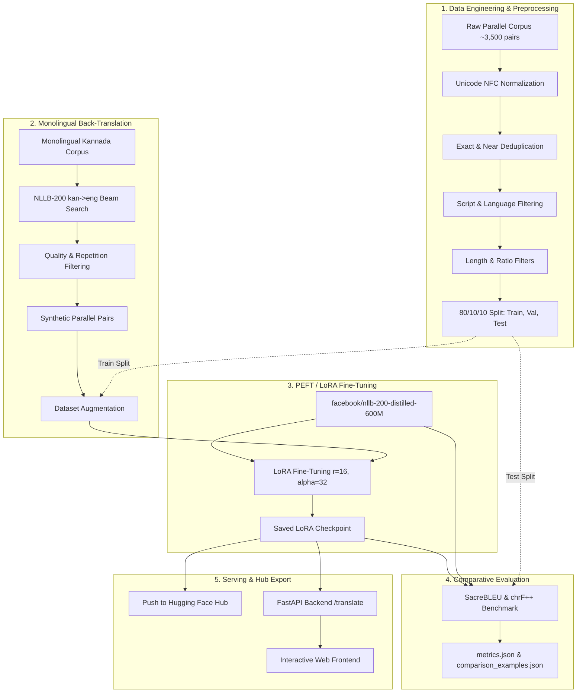
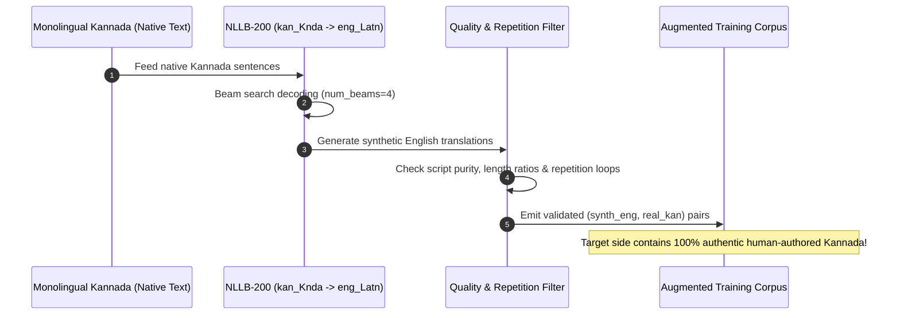

# LinguaBridge AI - Architecture & Technical Specification

LinguaBridge AI is a specialized, parameter-efficient Neural Machine Translation (NMT) system engineered for the low-resource language pair **English (`eng_Latn`) ↔ Kannada (`kan_Knda`)**. It leverages Meta AI's `facebook/nllb-200-distilled-600M` foundation model adapted through **LoRA (Low-Rank Adaptation)** and augmented with **iterative back-translation**.

---

## 1. High-Level System Architecture

---

## 2. Low-Resource NMT Challenges for Kannada

Kannada is a Dravidian language spoken by over 50 million people, yet it remains under-represented in modern deep learning corpora compared to high-resource languages:

1. **Morphological Agglutination:**
   Kannada attaches case suffixes (*vibhakti pratyaya*), tense markers, and plural markers directly onto root nouns and verbs.
   - Example: `ಶಾಲೆ` (school) -> `ಶಾಲೆಗಳು` (schools) -> `ಶಾಲೆಗಳಿಗಾಗಿ` (for the schools).
   - Standard word-level metric **BLEU** severely penalizes translations that predict the right root but have minor morphological inflection variations. Therefore, **chrF++ (Character n-gram F-score)** is essential.

2. **Unicode Complexities & Conjuncts (*Aksharas*):**
   Kannada glyphs are built by combining consonants with the virama (halant, `U+0CCD`) and vowel signs (*matras*).
   - In unnormalized text, these can appear as decomposed code points (NFD), splitting a single visual syllable across multiple subword tokenizer tokens.
   - **Enforcing Unicode Normalization Form C (NFC)** ensures deterministic subword chunking and prevents vocabulary fragmentation.

3. **Overfitting on Small Parallel Datasets (~3,500 pairs):**
   Full fine-tuning of 600M parameters on ~3,500 pairs causes catastrophic forgetting of multilingual representations.
   - LoRA freezes the foundation model weights and updates only $<1\%$ of parameters.

---

## 3. Back-Translation Mechanics (Target -> Source)

---

## 4. Parameter-Efficient Fine-Tuning (LoRA)

LoRA modifies the weight matrix update $\Delta W$ by factorizing it into two low-rank matrices $A$ and $B$:

$$W = W_0 + \Delta W = W_0 + \frac{\alpha}{r} (B \cdot A)$$

Where:
- $W_0 \in \mathbb{R}^{d \times k}$ (frozen pre-trained weights)
- $B \in \mathbb{R}^{d \times r}$ (initialized to zero)
- $A \in \mathbb{R}^{r \times k}$ (initialized with Gaussian distribution)
- $r = 16$ (rank)
- $\alpha = 32$ (scaling constant)

Targeting the query (`q_proj`), value (`v_proj`), key (`k_proj`), and output (`out_proj`) attention projections ensures maximum translation capability with minimal GPU memory overhead.
